# SRMact3_t4 — Actividad 3: CRUD en Spring Boot y relaciones JPA

**Autor:** Sandoval Reyes Miguel  
**Asignatura:** Programación Web  
**Proyecto:** SRMact3_t4  
**Tipo de aplicación:** API REST desarrollada en Spring Boot, sin frontend separado  
**Repositorio:** https://github.com/miguelsandovalreyeskgll/SRMact3_t4

## 1. Descripción general

El proyecto desarrolla una API REST para administrar alumnos y escuelas, utilizando **Spring Boot**, **Spring Data JPA** y una **base de datos MySQL real**. Se implementa un CRUD completo sobre la entidad `Alumno`, que permite **crear, consultar, actualizar y eliminar** registros mediante peticiones HTTP probadas con Bruno.

El sistema contiene dos entidades relacionadas: `Escuela` y `Alumno`. Cada alumno está asociado a una escuela y una escuela puede contar con varios alumnos. Los cambios se almacenan de forma persistente en MySQL, de modo que no se pierden al actualizar el navegador o reiniciar la aplicación.

La solución se desarrolló sin un proyecto de frontend independiente. Las operaciones se ejecutan mediante la API y se verifican tanto con **Bruno** como con consultas SQL.

## 2. Objetivo

Implementar y desplegar un CRUD completo en Spring Boot conectado a MySQL, utilizando dos entidades con una relación uno a muchos, separando la aplicación en capas de **Controller, Service y Repository**, y verificando las operaciones desde el equipo local y desde un VPS.

## 3. Tecnologías utilizadas

| Tecnología | Función |
|---|---|
| Java 17 (compatibilidad del proyecto) | Lenguaje de programación |
| Spring Boot 4.1.0 | Configuración y ejecución de la aplicación |
| Spring Web MVC | Controladores y endpoints REST |
| Spring Data JPA / Hibernate | Mapeo de entidades y persistencia |
| MySQL 8 | Base de datos relacional |
| Gradle Wrapper | Compilación y gestión de dependencias |
| Bruno | Pruebas de solicitudes HTTP |
| Git y GitHub | Control de versiones y repositorio |
| Ubuntu 24.04 y systemd | Ejecución del proyecto en el VPS |

## 4. Modelo de datos y relación entre entidades

Las entidades se representan mediante las clases `Escuela.java` y `Alumno.java`, ubicadas en el paquete `modelo`.

```text
ESCUELA                          ALUMNO
------------------               ------------------
id (PK)                 1 ─── N  id (PK)
nombre                           nombre
                                 escuela_id (FK)
```

La relación implementada es **uno a muchos (1:N)**:

- `Escuela.java` declara `@Entity` y `@OneToMany(mappedBy = "escuela")`.
- `Alumno.java` declara `@Entity`, `@ManyToOne` y `@JoinColumn(name = "escuela_id")`.
- La columna `alumno.escuela_id` funciona como llave foránea hacia `escuela.id`.
- La respuesta de la API incluye `escuelaId` y `escuelaNombre`, permitiendo identificar claramente la escuela asociada a cada alumno.

La relación puede comprobarse mediante la siguiente consulta:

```sql
USE srmact3_db;
SELECT a.id, a.nombre AS alumno, e.nombre AS escuela
FROM alumno a
INNER JOIN escuela e ON a.escuela_id = e.id;
```

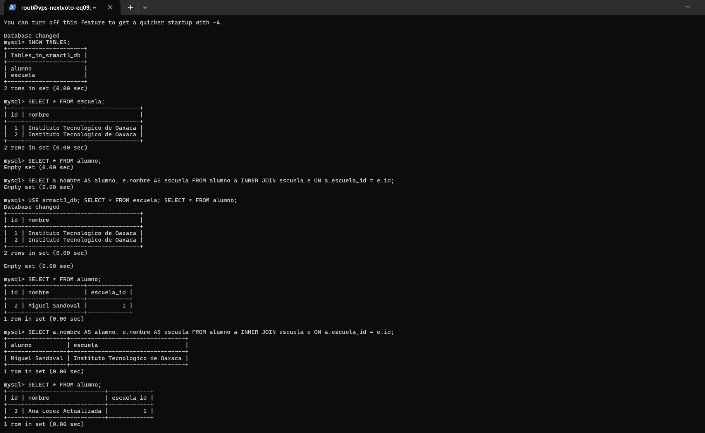

## 5. Estructura del proyecto

```text
SRMact3_t4/
├── src/main/java/com/srm/actividad3/
│   ├── Actividad3Application.java
│   ├── modelo/
│   │   ├── Escuela.java
│   │   └── Alumno.java
│   ├── dto/
│   │   └── AlumnoDTO.java
│   ├── repositorio/
│   │   ├── EscuelaRepository.java
│   │   └── AlumnoRepository.java
│   ├── servicio/
│   │   ├── EscuelaService.java
│   │   └── AlumnoService.java
│   └── controlador/
│       ├── EscuelaController.java
│       └── AlumnoController.java
├── src/main/resources/application.properties
├── bruno/
├── sql/
├── docs/capturas/
├── build.gradle
├── gradlew.bat
└── README.md
```

### Organización por capas

**Controller:** recibe las solicitudes HTTP y envía las respuestas de la API. Los endpoints están definidos en `AlumnoController.java` y `EscuelaController.java`.

**Service:** contiene la lógica de negocio, valida los datos, comprueba la existencia de la escuela y realiza las operaciones requeridas. Se implementa en `AlumnoService.java` y `EscuelaService.java`.

**Repository:** permite consultar, insertar, actualizar y eliminar registros mediante las interfaces de Spring Data JPA que extienden `JpaRepository`.

**DTO:** `AlumnoDTO.java` es un `record` de Java utilizado para intercambiar los datos del alumno (`id`, `nombre`, `escuelaId` y `escuelaNombre`) sin exponer directamente toda la entidad JPA.

El flujo de una petición se organiza así:

```text
Cliente Bruno → Controller → Service → Repository → MySQL
```

## 6. Endpoints implementados

### Escuela

| Método HTTP | Endpoint | Descripción |
|---|---|---|
| GET | `/api/escuelas` | Consultar todas las escuelas |
| POST | `/api/escuelas` | Registrar una escuela |

### Alumno — CRUD completo

| Operación | Método HTTP | Endpoint | Descripción |
|---|---|---|---|
| Create | POST | `/api/alumnos` | Registrar un alumno y asignarle una escuela |
| Read | GET | `/api/alumnos` | Consultar todos los alumnos |
| Read | GET | `/api/alumnos/{id}` | Consultar un alumno mediante su ID |
| Update | PUT | `/api/alumnos/{id}` | Modificar el nombre o la escuela de un alumno |
| Delete | DELETE | `/api/alumnos/{id}` | Eliminar un alumno existente |

### Ejemplos de cuerpos JSON

**Registrar una escuela — POST `/api/escuelas`:**

```json
{
  "nombre": "Instituto Tecnologico de Oaxaca"
}
```

**Registrar un alumno — POST `/api/alumnos`:**

```json
{
  "nombre": "Axel Eliel",
  "escuelaId": 1
}
```

**Actualizar un alumno — PUT `/api/alumnos/{id}`:**

```json
{
  "nombre": "Ana Lopez",
  "escuelaId": 1
}
```

Los códigos HTTP utilizados incluyen `200 OK` para consultas y actualizaciones, `201 Created` para creaciones y `204 No Content` para eliminaciones exitosas. Cuando se solicita un alumno inexistente, la API devuelve `404 Not Found`.

Los valores de ID empleados en los ejemplos deben sustituirse por los identificadores reales generados en MySQL.

## 7. Evidencias del CRUD en el entorno local

El proyecto se ejecutó localmente en `http://localhost:8083`, conectado a la base de datos MySQL alojada en el VPS mediante un túnel SSH. Las siguientes evidencias corresponden a distintas etapas de las pruebas.

### 7.1. Creación de una escuela (POST)

Se envió un objeto JSON desde Bruno para registrar una escuela. La respuesta `201 Created` confirma la creación del recurso.

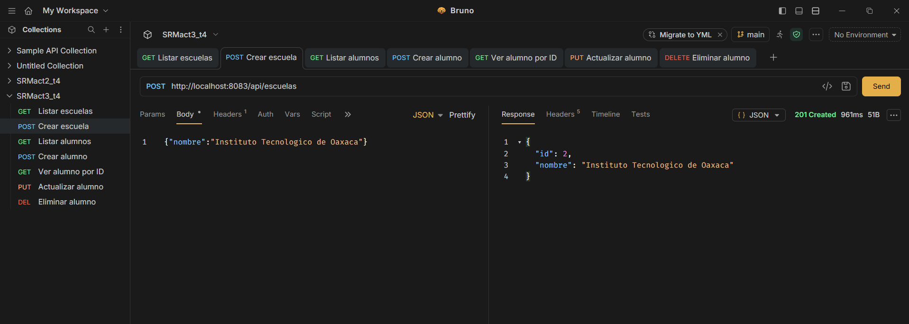

### 7.2. Creación de un alumno (POST)

Se registró un alumno indicando su nombre y el identificador de una escuela previamente creada.

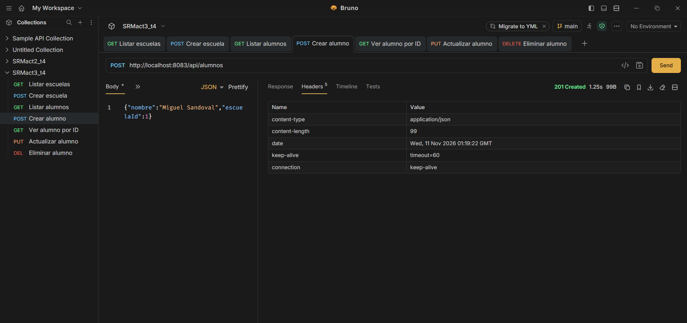

### 7.3. Consulta de alumno (GET)

Se recuperó la información de un alumno mediante su identificador. En la respuesta se incluyen los datos de la escuela relacionada.

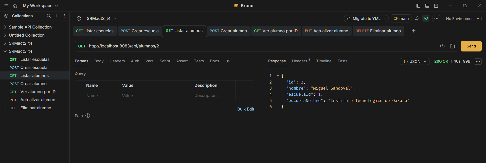

### 7.4. Actualización de alumno (PUT)

Se modificó el nombre del alumno mediante una solicitud PUT. La respuesta `200 OK` muestra los datos actualizados.

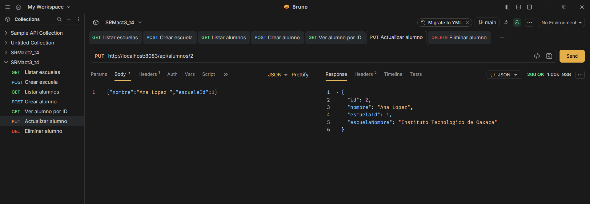

Se realizó posteriormente una consulta GET para corroborar la modificación.

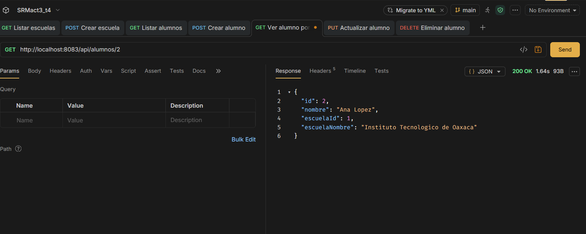

### 7.5. Eliminación de alumno (DELETE)

Se envió una solicitud DELETE para eliminar el alumno con el ID utilizado en la prueba. El servidor respondió `204 No Content`.

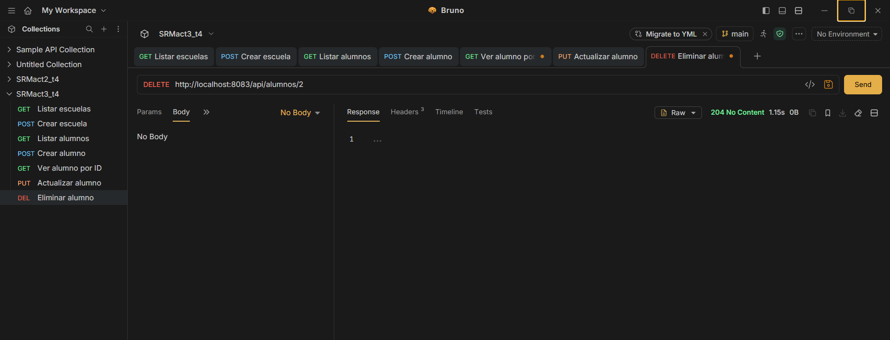

La consulta SQL posterior mostró que la tabla `alumno` quedó vacía, de acuerdo con los registros presentes en ese momento.

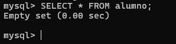

## 8. Despliegue y pruebas desde el VPS

La aplicación se compiló con Gradle mediante `gradlew.bat bootJar` y se desplegó como archivo ejecutable JAR en el VPS con **Ubuntu 24.04**. Se creó el servicio `srmact3.service` de **systemd**, configurado para ejecutar Spring Boot en el **puerto 8084**.

La configuración de MySQL se establece mediante variables de entorno (`DB_URL`, `DB_USER` y `DB_PASSWORD`) sin publicar las credenciales en GitHub. La conexión desde la aplicación desplegada se realiza al servicio MySQL del mismo VPS mediante `127.0.0.1:3306`.

**Dirección base pública:** `http://167.99.15.140:8084`

**Consulta de escuelas:** http://167.99.15.140:8084/api/escuelas  
**Consulta de alumnos:** http://167.99.15.140:8084/api/alumnos

### 8.1. Consulta de escuelas desde internet

La petición GET al VPS devolvió las escuelas almacenadas en MySQL. Durante las pruebas se habían creado dos registros con el mismo nombre y diferentes identificadores.

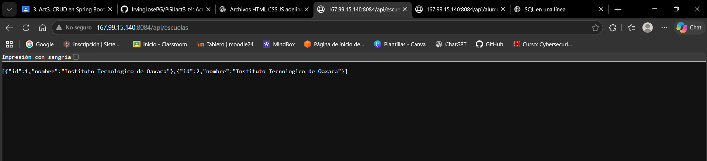

### 8.2. Consulta de alumnos desde internet

La petición GET devolvió una lista vacía porque el alumno de la prueba local ya había sido eliminado. Este resultado demuestra que el endpoint respondió correctamente; no representa un error del servidor.

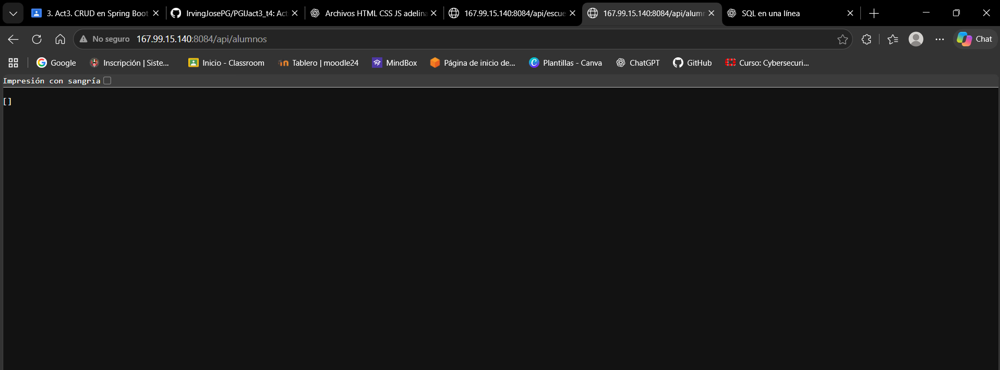

### 8.3. Registro remoto de un alumno y persistencia

Desde Bruno se realizó un POST directamente contra la IP pública del VPS. El servidor respondió `201 Created` al registrar al alumno **Axel Eliel** asociado a la escuela con ID `1`.

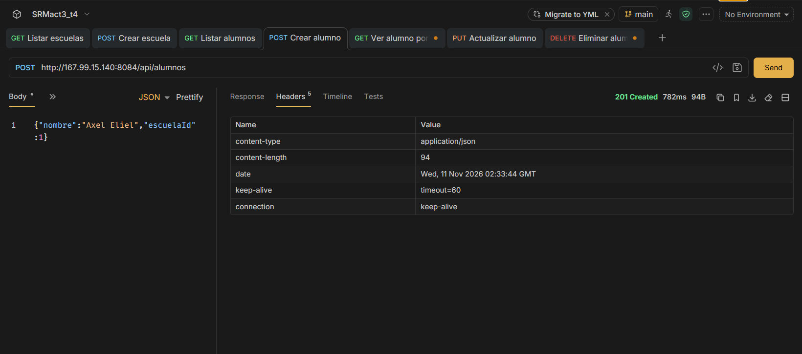

Finalmente, se verificó en la terminal MySQL del VPS que el registro efectivamente estaba almacenado en la tabla `alumno`. En esta prueba MySQL asignó al alumno el identificador `3`.

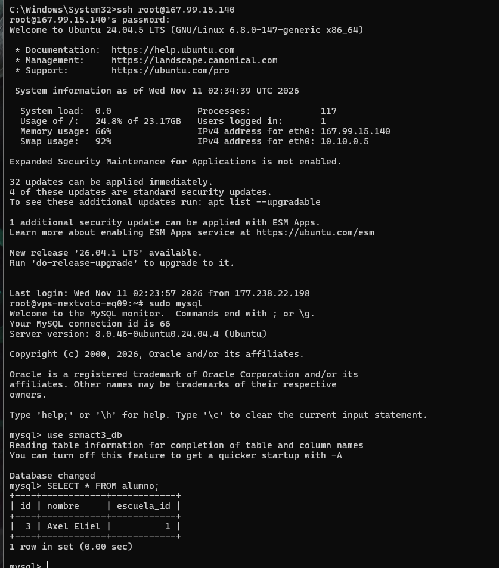

## 9. Ejecución y verificación

### Entorno local

En Windows, el proyecto se ejecuta desde su carpeta raíz con el Gradle Wrapper. Cuando MySQL se encuentra solamente en el VPS, se puede establecer un túnel SSH desde otra terminal de Windows:

```cmd
ssh -N -L 3307:127.0.0.1:3306 root@167.99.15.140
```

En un CMD distinto, dentro de `SRMact3_t4`, se configuran las variables y se ejecuta Spring Boot:

```cmd
set "DB_URL=jdbc:mysql://127.0.0.1:3307/srmact3_db"
set "DB_USER=srmact3"
set "DB_PASSWORD=CONTRASENA_MYSQL_CONFIGURADA"
gradlew.bat bootRun
```

Las variables establecidas con `set` tienen alcance solamente en la sesión de CMD correspondiente; se deben configurar de nuevo al abrir otra terminal. El valor de la contraseña mostrado es un marcador de posición y no debe subirse al repositorio.

### Entorno VPS

El proyecto se encuentra en `/var/www/SRMact3_t4/`. Los siguientes comandos permiten revisar su funcionamiento:

```bash
sudo systemctl status srmact3 --no-pager
sudo ss -ltnp | grep ':8084'
curl -i http://127.0.0.1:8084/api/escuelas
curl -i http://127.0.0.1:8084/api/alumnos
```

La base de datos puede verificarse con:

```sql
USE srmact3_db;
SHOW TABLES;
SELECT * FROM escuela;
SELECT * FROM alumno;
SELECT a.nombre AS alumno, e.nombre AS escuela
FROM alumno a INNER JOIN escuela e ON a.escuela_id = e.id;
```

El proyecto mantiene un directorio, un puerto y un servicio independientes de los utilizados por las actividades anteriores.

## 10. Respuestas a las preguntas de la actividad

**a) ¿Qué dos entidades se eligieron y qué relación se implementó?**  
Se eligieron `Escuela` y `Alumno`, con una relación **uno a muchos (1:N)**. Una escuela puede tener varios alumnos, mientras que cada alumno pertenece a una sola escuela. La relación se representa con `@OneToMany` y `@ManyToOne` y se almacena mediante la llave foránea `escuela_id` de la tabla `alumno`.

**b) ¿Qué es un Repository en Spring Data JPA y qué ventaja tiene sobre escribir las consultas SQL?**  
Un Repository es una interfaz para acceder a datos mediante JPA. En el proyecto se utilizaron `EscuelaRepository` y `AlumnoRepository`, que extienden `JpaRepository`. Esto proporciona operaciones habituales como `save`, `findAll`, `findById` y `delete`, reduciendo la necesidad de escribir consultas SQL manuales para el CRUD básico.

**c) ¿Por qué conviene separar la lógica de negocio en una capa Service?**  
La capa Service concentra validaciones y operaciones de negocio, como comprobar que exista la escuela antes de asociarla a un alumno. Esta separación permite que el Controller se dedique a recibir y responder solicitudes HTTP y que el Repository maneje el acceso a la base de datos. Así se facilita el mantenimiento, la organización y las pruebas de la aplicación.

**d) Enlaces de GitHub, VPS y pruebas:**  
- **Repositorio GitHub:** https://github.com/miguelsandovalreyeskgll/SRMact3_t4
- **VPS — escuelas:** http://167.99.15.140:8084/api/escuelas
- **VPS — alumnos:** http://167.99.15.140:8084/api/alumnos
- **Colección Bruno:** carpeta [`bruno/`](bruno/), con las peticiones GET, POST, PUT y DELETE.

## 11. Conclusión

El proyecto implementa un CRUD funcional de alumnos utilizando Spring Boot y Spring Data JPA, con persistencia real en MySQL y una relación entre dos entidades. Las pruebas locales permitieron verificar la creación, consulta, actualización y eliminación de registros. El despliegue al VPS permitió comprobar, además, el acceso público a la API y el almacenamiento remoto de nuevos registros. El desarrollo emplea una estructura organizada en Controller, Service, Repository y DTO, facilitando la comprensión y el mantenimiento del código.

---

**Elaborado por:** Sandoval Reyes Miguel  
**Asignatura:** Programación Web
